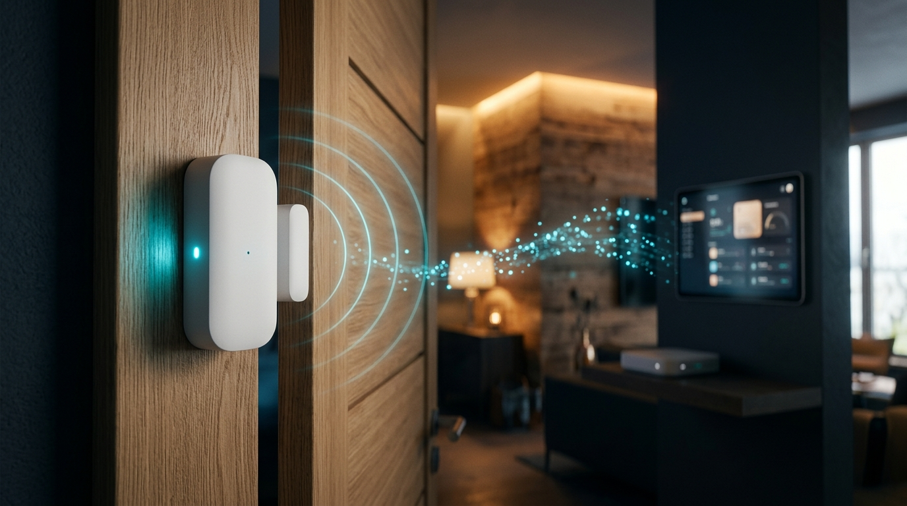

<div align="center">

# 🚪 Sonoff DW2-Wi-Fi — Custom BLE Firmware

<p align="center">
  
</p>

<p align="center">
  <b>Turn your Sonoff DW2 into a 100% private, ultra-low-power door & window sensor for Home Assistant.</b>
</p>

<!-- Project Badges -->
<p align="center">
  <a href="LICENSE"></a>
  <a href="https://bthome.io/"></a>
  
  
</p>

<!-- Navigation -->
<p align="center">
  <a href="#-why-this-project">✨ <b>Why This Project?</b></a> •
  <a href="#-stock-vs-custom">⚖️ <b>Stock vs Custom</b></a> •
  <a href="#-home-assistant-setup">🏠 <b>Home Assistant</b></a> •
  <a href="#-button--led-guide">🎛️ <b>Button & LED</b></a> •
  <a href="#-how-to-flash">🚀 <b>How to Flash</b></a> •
  <a href="#-for-developers">🔬 <b>For Developers</b></a>
</p>

<br/>

<p align="center">
  
</p>

---

</div>

## ✨ Why This Project?

The original Sonoff DW2-Wi-Fi connects directly to Wi-Fi and the eWeLink cloud, draining two AAA batteries in just 2 to 3 months and having noticeable delay.

This custom firmware transforms the sensor into a pure **Bluetooth (BLE)** smart sensor:

* **🏠 100% Local & Private:** No cloud accounts, no third-party servers, and zero internet dependency. Everything stays private in your home.
* **🔋 ~2 Years Battery Life:** Eliminates power-hungry Wi-Fi reconnects. Standard AAA batteries last up to 2 years.
* **⚡ Shows Up Automatically in Home Assistant:** Native BTHome discovery means Home Assistant discovers it as soon as the door opens or closes — no YAML editing required.
* **📡 Wireless Updates:** After a one-time initial setup, all future firmware updates are flashed wirelessly over Bluetooth.
* **⏱️ Door Duration & Ajar Warning:** Tells you exactly how long the door was open, and alerts you if left open for more than 45 seconds.

---

## ⚖️ Stock vs Custom

| Feature | Stock Sonoff Firmware | Custom Firmware (This Project) |
|---|---|---|
| **Privacy** | ❌ Tethered to eWeLink cloud servers | ✅ **100% Local & Private** (Zero cloud dependency) |
| **Connection** | ⚠️ Wi-Fi (reconnect delay on every event) | ⚡ **Instant Bluetooth** (Immediate response) |
| **Battery Life** | ❌ 2–3 months on 2× AAA | 🚀 **~2 Years** on standard AAA alkaline cells |
| **Home Assistant** | ⚠️ Cloud integration or custom tokens | 🏠 **Automatic Auto-Discovery** (Zero configuration) |
| **Firmware Updates** | ❌ Locked cloud / serial only | 📡 **Wireless Over-The-Air** (No cables needed) |

---

## 🏠 Home Assistant Setup

No custom add-on or YAML configuration is required:

1. Ensure Bluetooth or a Bluetooth Proxy (such as an ESPHome Bluetooth Proxy) is running on your network.
2. In Home Assistant, go to **Settings -> Devices & Services**.
3. A notification will appear: **"New device discovered: BTHome"**.
4. Click **Configure**, and your new door sensor is ready to use!

> [!TIP]
> If Home Assistant doesn't see it right away, open and close the door once or press the small internal button (`S1`) to wake the sensor.

---

## 🎛️ Button & LED Guide

The sensor has one indicator LED and one small button inside the casing (`S1`):

| Action | How to Trigger | LED Feedback | What Happens |
|---|---|---|---|
| **Door Opened** | Separate magnet from sensor | 1 short blink | Broadcasts "Open" state to Home Assistant. |
| **Door Closed** | Bring magnet back to sensor | 2 short blinks | Broadcasts "Closed" state and how long it was open. |
| **Update Mode (OTA)** | Press `S1` once (or flick magnet 5 times) | 5 rapid blinks | Opens a 3-minute wireless connection window for updates. |
| **Hard Reboot** | Hold `S1` for **8–10 seconds** | 1 blink at 8s, then rapid blinks | Safely restarts the sensor without losing any history. |
| **Factory Reset** | Hold `S1` for **15+ seconds** | LED stays continuously lit | Formats the internal event log and restarts fresh. |
| **Cancel Action** | Release button between 5–8s or 10–15s | None | Safe cancellation window — nothing changes. |

---

## 🚀 How to Flash

Transitioning from the original firmware requires connecting a USB-to-UART serial adapter **only once** to install the wireless bootloader. After this, all future updates are done **100% wirelessly over Bluetooth**.

<details>
<summary><b>Step 1: First-time flash (needs a 3.3V USB-to-UART adapter, once)</b></summary>
<br/>

Solder 4 temporary jumper wires (or use pogo pins) to header `J2` on the back of the DW2 board:

```text
USB Adapter (3.3V)        Sonoff DW2 PCB (Header J2)
------------------        --------------------------
3.3V (VCC)       -------> 3V3
GND              -------> GND
RXD              -------> TXD
TXD              -------> RXD
```

> [!CAUTION]
> Use **3.3V logic levels only** (5V will permanently damage the chip). Remove AAA batteries while powering via USB.

1. Open `third_party/OPL1000A2-SDK/Tool/Download/download_RELEASE.exe`.
2. Select your COM port, Baud rate `115200`.
3. Choose the firmware file: `third_party/OPL1000A2-SDK/Tool/Download/Patch/opl1000.bin`.
4. Click **Start**, then connect 3.3V power (or touch `RST` to `GND`). Flashing finishes in ~15 seconds.
5. Disconnect wires, insert AAA batteries, and close the case.

</details>

<details open>
<summary><b>Step 2: Future wireless updates (Over-The-Air)</b></summary>
<br/>

Once the bootloader is installed, you never need serial cables again:

1. Press `S1` once (or flick the magnet 5 times). The LED flashes 5 times.
2. Run the update command from your computer:
   ```powershell
   python tools/dw2_tool.py ota
   ```

</details>

<details>
<summary><b>Handy CLI commands (`tools/dw2_tool.py`)</b></summary>
<br/>

```powershell
# Live packet monitor & event scanner
python tools/dw2_tool.py scan --timeout 30

# Synchronize internal clock with computer time
python tools/dw2_tool.py sync-time

# View the last 20 recorded door events
python tools/dw2_tool.py dump-logs

# Export complete event history to CSV
python tools/dw2_tool.py dump-logs --all --out history.csv
```

</details>

---

## 🔬 For Developers

<details>
<summary><b>Hardware Architecture, Memory Map, Packet Structure & ESP32 Code</b></summary>
<br/>

### 📐 Hardware Specifications (PCB V1.2)

```text
       +---------------------------------------------+
       | [J2 Header: 3V3  TXD  RXD  GND]             |
       |                                             |
       |   +-----------------------+     [LED1]      |
       |   |   Opulinks OPL1000    |                 |
       |   |  Cortex-M3 + M0 SoC   |     [S1 Button] |
       |   +-----------------------+                 |
       |                                             |
       |   [BoyaMicro 25Q80 Flash]       [H1 Hall]   |
       +---------------------------------------------+
```

| Component | Designator | Specification / Role |
|---|---|---|
| **SoC** | `U1` | Opulinks OPL1000 A2 (ARM Cortex-M3 @ 44–176 MHz + Cortex-M0) |
| **SPI NOR Flash** | `U2` | BoyaMicro 25Q80 (1 MB / 8 Mbit SPI Flash) |
| **Magnetic Sensor** | `H1` | Hall Effect switch on `IO5` (Active Low: Magnet present = Closed) |
| **Maintenance Button** | `S1` | Tactile push button on `IO4` (Active Low) |
| **Indicator LED** | `LED1` | Surface-mount LED on `IO21` (Active High) |
| **Battery AuxADC** | Internal | Internal rail measurement + OTP factory regression calibration |
| **Serial Header** | `J2` | 4-pin 2.54mm pitch: `3V3`, `TXD`, `RXD`, `GND` |
| **Debug UART** | `IO8` | Single-wire 115200 bps Debug UART TX (kernel boot logs) |
| **Power Source** | — | 2 × AAA Alkaline / NiMH batteries (nominal 3.0 V) |

---

### 🗺️ 1 MB SPI Flash Memory Map

```text
0x00000000 +-------------------------------------------------------+
           | 2nd Stage Boot Agent (opl1000_ota_loader.bin)   (12 KB)|
0x00003000 +-------------------------------------------------------+
           | OTA Header 1 (Bank 0 Descriptor & Checksum)      (4 KB)|
0x00004000 +-------------------------------------------------------+
           | OTA Header 2 (Bank 1 Descriptor & Checksum)      (4 KB)|
0x00005000 +-------------------------------------------------------+
           | Dual-Bank 0 (Primary Application Firmware)     (228 KB)|
0x0003E000 +-------------------------------------------------------+
           | Dual-Bank 1 (OTA Staging Firmware)             (228 KB)|
0x00077000 +-------------------------------------------------------+
           | Opulinks RF Calibration, MAC & NVS Storage     (420 KB)|
0x000E0000 +-------------------------------------------------------+
           | Blackbox Event Logger (32 x 4 KB Sectors, 8,192) (128 KB)|
0x00100000 +-------------------------------------------------------+
```

---

### 📊 BLE Broadcast Packet Structure

Broadcasts inside BLE `Manufacturer Specific Data` (`0xFF`):

| Offset | Field | Type | Description |
|---|---|---|---|
| `+0` | Company ID | `uint16_t` | `0xFFFF` (Custom / Experimental) |
| `+2` | Magic Header | `uint8_t[2]` | `'D'`, `'W'` (`0x44, 0x57`) |
| `+4` | Protocol Version | `uint8_t` | `0x02` (Epoch timestamp + BTHome V2) |
| `+5` | Status Flags | `uint8_t` | Bitfield: Door Open, Ajar, Low Battery, etc. |
| `+6` | Event Counter | `uint32_t` | Monotonic sequential counter (anti-replay) |
| `+10` | Epoch Timestamp | `uint32_t` | Unix Epoch UTC seconds (`0` if unsynced) |
| `+14` | Battery Voltage | `uint16_t` | Millivolts (e.g. `3050` = 3.05 V) |
| `+16` | Open Duration | `uint16_t` | Duration door was open in seconds (sent on Close) |
| `+18` | BTHome Object ID | `uint8_t` | `0x1A` (Standard BTHome V2 Door Object) |
| `+19` | BTHome Value | `uint8_t` | `0x00` = Closed, `0x01` = Open |

---

### 📟 Standalone ESP32 Receiver C++ Snippet

A lightweight header-only receiver is in `esp32_receiver/dw2_ble_receiver.hpp`:

```cpp
#include "dw2_ble_receiver.hpp"

DW2Receiver receiver;

void onDoorEvent(const dw2_event_t &evt) {
    printf("Sensor [%s] | State: %s | Battery: %u mV | Duration: %u s\n",
           evt.mac, evt.is_open ? "OPEN" : "CLOSED", evt.battery_mv, evt.open_duration_sec);

    if (evt.is_open && evt.is_ajar) {
        // Door open > 45s: turn off radiator valve
        radiator_turn_off();
    }
}

void app_main() {
    receiver.setCallback(onDoorEvent);
    receiver.begin();
}
```

---

### 🛠️ Building From Source

Prerequisites: `arm-none-eabi-gcc` 14.2+ and `make`.

```powershell
python tools/dw2_tool.py build
```

</details>

---

## 📄 License & Credits

- **Firmware & CLI:** MIT License. Created by [Bogdan](https://github.com/RoDTOX) & Antigravity (Google DeepMind).
- **Opulinks OPL1000 SDK:** Copyright (c) Opulinks Technology Ltd.
- **Hardware Design:** Sonoff / ITEAD Intelligent Systems Co., Ltd.
